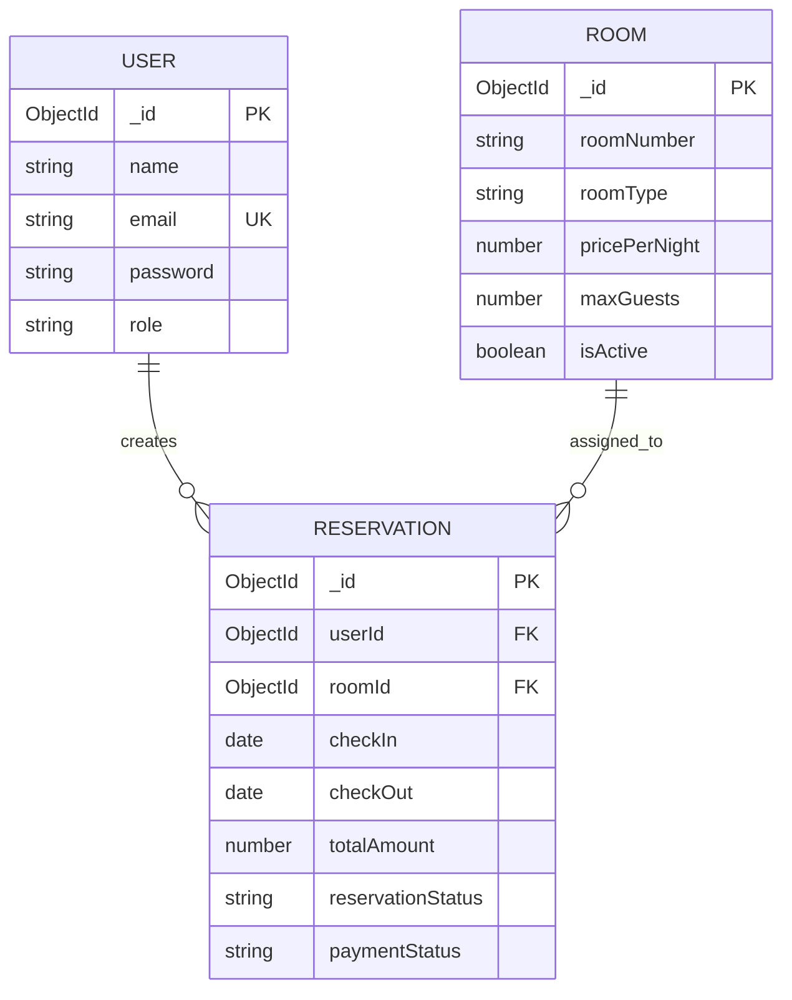

# HotelPro — Luxury Hotel Booking & Management System

HotelPro is a complete, reference-guided full-stack hotel reservation and property management system built with **React**, **Vite**, **Node.js**, **Express**, **MongoDB / Mongoose**, **JWT Authentication**, and **CSS/Bootstrap**.

Designed following the visual identity of the **Sogo Luxury Resort** template, HotelPro combines an opulent guest-facing experience with a full-featured administrative operations portal.

---

## 🌟 Key Features & Architectural Highlights

### 1. Visual & UX Preservation (Sogo Design Language)
- **Palette & Typography**: Signature gold accent (`#ffba5a`), dark obsidian headings, warm ivory backgrounds, `Playfair Display` serif headlines, and clean `Roboto` body typography.
- **Interactive Availability Bar**: Check-in / check-out date picker, guest count selection, and instant availability filtering.
- **Room Showcase**: Luxury card layouts with image hover animations, bed type badges, max guest limits, square footage, and amenities.
- **Interactive Modals**: Full room detail modal with photo gallery and booking summary, plus a test-mode payment simulation dialog.
- **Responsive Navigation**: Brand navbar with transparent-to-solid transitions, guest account controls, and mobile navigation drawer.

### 2. Guest Journey
- **Room Search & Discovery**: Filter rooms by date range, room type (Single, Double, Deluxe, Suite, Presidential), price range, or guest capacity.
- **Secure Authentication**: Register and login with JWT bearer token persistence and role enforcement.
- **Server-Side Pricing**: Calculates stay duration, nightly rates, 10% hospitality tax, and flat service fees server-side. Client-supplied price totals are never trusted.
- **Reservation Lifecycle**: Confirmed bookings, real-time availability updates, and guest self-service cancellation with simulated refund status.
- **Guest Booking Dashboard (`/my-bookings`)**: View all past and upcoming stays with live payment and reservation badges.

### 3. Administrator Operations Portal (`/admin`)
- **Executive KPI Dashboard**:
  - Live Occupancy rate (%) calculated against active rooms.
  - Actual gross revenue aggregated exclusively from paid, active reservations.
  - Today's expected arrivals and departures.
  - Room status breakdown (active vs inactive inventory).
  - Recent reservations activity feed.
- **Room Inventory Management (`/admin/rooms`)**: Add new rooms, edit room metadata, update pricing, and toggle rooms active/inactive.
- **Reservation Management (`/admin/reservations`)**: Filter by reservation status, search by guest name/email, and manage lifecycle transitions (`Pending` &rarr; `Confirmed` &rarr; `Checked-In` &rarr; `Checked-Out` &rarr; `Cancelled`).
- **Guest Directory (`/admin/guests`)**: Complete directory of registered guests with total bookings made, total spend, and last booking date.

### 4. Enterprise Security & Integrity
- **Strict Status Separation**: `reservationStatus` (`Pending`, `Confirmed`, `Checked-In`, `Checked-Out`, `Cancelled`) is decoupled from `paymentStatus` (`Unpaid`, `Paid`, `Refunded`).
- **Atomic Collision Rejection**: Overlapping reservation attempts for the same room return an HTTP `409 Conflict` error to prevent double-booking.
- **Credential Protection**: Passwords hashed with `bcryptjs` (10 salt rounds), password field excluded by default (`select: false`).
- **Role-Based Access Control**: Middleware (`protect` and `adminOnly`) verifies tokens and rejects unauthorized role access (`403 Forbidden`).

---

## 🗄️ Database Architecture & Dual-Mode Engine

HotelPro is built on standard **Mongoose** models with full MongoDB schema validations and indexes.

- **Production Mode (Live MongoDB)**: Connects to MongoDB via standard `MONGODB_URI` environment variable.
- **Autonomous In-Memory Fallback Engine**: If no live MongoDB daemon is detected on startup or during automated test runs (`NODE_ENV=test`), HotelPro automatically activates its high-fidelity in-memory database engine. This engine supports full query chaining (`.select()`, `.populate()`, `.sort()`, `.limit()`), document lifecycle methods (`save()`, `matchPassword()`), and MongoDB aggregations with zero external binary download required.

## 🗄️ Database ER Diagram

HotelPro uses a relational-style entity structure implemented through MongoDB collections and Mongoose schemas. The Entity Relationship Diagram (ERD) illustrates the relationships between users, room inventory, and reservations.

### Entity Relationship Diagram



### Entity Relationships

| Relationship | Cardinality | Description |
|---|---|---|
| User → Reservation | One-to-Many | A registered guest can create multiple reservations. |
| Room → Reservation | One-to-Many | A room can be associated with multiple reservations over time, provided their booking dates do not overlap. |
| Reservation → User | Many-to-One | Every reservation belongs to one user. |
| Reservation → Room | Many-to-One | Every reservation references one room. |

### Database Integrity Rules

- Every reservation must reference an existing user and room.
- A room cannot have overlapping active reservations.
- Reservation status and payment status are maintained independently.
- Room availability is calculated using check-in/check-out dates and reservation lifecycle status.
- Passwords are stored as bcrypt hashes, never as plaintext.
- Foreign-key-style references are maintained using MongoDB ObjectIds and Mongoose references.

**Note:** The ER diagram represents the logical database architecture. Actual field names and references should match the implemented Mongoose schemas.

---

## 🧪 Automated Test Suite

HotelPro includes an automated integration test suite covering authentication, room search, reservation integrity, and admin operations.

### Running the Test Suite:
```bash
npm test
```
*(Or directly within backend: `npm test --prefix backend`)*

### Test Results Summary:
- **Suites**: 4 passed, 4 total
- **Tests**: 15 passed, 0 failed
- **Coverage**:
  - `auth.test.js`: User registration, duplicate email rejection, login credential validation, bad password rejection, JWT user profile retrieval.
  - `rooms.test.js`: Admin room creation, guest forbidden room creation (`403`), date-based availability search and exclusion of booked rooms.
  - `reservations.test.js`: Server-side pricing calculation, overlapping date collision rejection (`409 Conflict`), unauthorized cancellation rejection (`403`), guest self-cancellation and refund update.
  - `admin.test.js`: KPI metrics calculations (occupancy, revenue, counts), check-in to check-out status transition, unauthorized guest access rejection (`403`).

---

## 🚀 Quick Start Guide

### Prerequisites
- Node.js (v18.0.0 or higher recommended)
- npm (v9.0.0 or higher)

### 1. Installation
Install dependencies in both backend and frontend:
```bash
npm install --prefix backend
npm install --prefix frontend
```

### 2. Environment Setup
Default `.env` configuration files are pre-configured. You can customize them if needed:
- **Backend Configuration** (`backend/.env`):
  ```env
  PORT=5000
  NODE_ENV=development
  MONGODB_URI=mongodb://localhost:27017/hotelpro
  JWT_SECRET=hotelpro_super_secret_jwt_key_2026_production_grade
  JWT_EXPIRES_IN=30d
  ```
- **Frontend Configuration** (`frontend/.env`):
  ```env
  VITE_API_URL=http://localhost:5000/api
  ```

### 3. Seed Database
Seed initial luxury rooms, default admin, guest users, and sample bookings:
```bash
npm run seed
```

#### Default Credentials:
| Role | Email | Password |
|---|---|---|
| **Hotel Administrator** | `admin@hotelpro.com` | `admin123` |
| **Guest** | `guest@hotelpro.com` | `guest123` |

### 4. Running the Application
Open two terminal windows:

**Terminal 1 — Backend API Server:**
```bash
npm run dev:backend
```
*API server runs at `http://localhost:5000` (Health check: `http://localhost:5000/api/health`)*

**Terminal 2 — Frontend Application:**
```bash
npm run dev:frontend
```
*Vite frontend runs at `http://localhost:5173`*

### 5. Production Build
To create an optimized production build of the frontend:
```bash
npm run build
```
*(Generates production assets in `frontend/dist/`)*

---

## 📁 Project Structure

```
HotelPro/
├── package.json              # Root orchestration scripts (test, seed, build, dev)
├── README.md                 # Project documentation and specifications
│
├── backend/
│   ├── package.json          # Express, Mongoose, JWT, bcryptjs, supertest
│   ├── .env.example          # Backend environment template
│   ├── .env                  # Backend active environment variables
│   ├── src/
│   │   ├── app.js            # Express application setup & middleware
│   │   ├── server.js         # HTTP server entrypoint & seed auto-check
│   │   ├── config/
│   │   │   ├── db.js         # MongoDB connection & engine switcher
│   │   │   └── memoryDb.js   # High-fidelity in-memory Mongoose query engine
│   │   ├── models/
│   │   │   ├── User.js       # User schema & password hashing
│   │   │   ├── Room.js       # Room inventory schema
│   │   │   └── Reservation.js# Reservation & payment status schema
│   │   ├── middleware/
│   │   │   └── auth.js       # protect & adminOnly JWT verification
│   │   ├── controllers/
│   │   │   ├── authController.js
│   │   │   ├── roomController.js
│   │   │   ├── reservationController.js
│   │   │   └── adminController.js
│   │   ├── routes/
│   │   │   ├── authRoutes.js
│   │   │   ├── roomRoutes.js
│   │   │   ├── reservationRoutes.js
│   │   │   └── adminRoutes.js
│   │   └── utils/
│   │       ├── pricing.js    # Stay duration & financial calculation
│   │       ├── seedData.js   # Seed definitions & luxury inventory
│   │       └── seedRunner.js # Standalone database seeder
│   └── tests/
│       ├── testClient.js     # In-memory HTTP test harness
│       ├── auth.test.js      # Authentication test suite
│       ├── rooms.test.js     # Room discovery & availability test suite
│       ├── reservations.test.js # Overlap & price integrity test suite
│       └── admin.test.js     # Administrative metrics & operations test suite
│
├── frontend/
│   ├── package.json          # React, Vite, React Router, Lucide Icons
│   ├── vite.config.js        # Vite build & proxy configuration
│   ├── index.html            # HTML template with Google Fonts (Playfair & Roboto)
│   ├── public/
│   │   └── images/           # Sogo luxury resort photography & assets
│   └── src/
│       ├── main.jsx          # React DOM entry point
│       ├── App.jsx           # Client-side routing & route guards
│       ├── styles/
│       │   └── hotelpro.css  # Sogo luxury resort design system & styles
│       ├── context/
│       │   └── AuthContext.jsx # Global JWT session state & persistence
│       ├── services/
│       │   └── api.js        # Axios-compatible Fetch client with auth headers
│       ├── components/
│       │   ├── Navbar.jsx    # Responsive header with role navigation
│       │   ├── Footer.jsx    # Resort footer & newsletter
│       │   ├── BookingBar.jsx# Date & guest search filter widget
│       │   ├── RoomCard.jsx  # Room listing card with Sogo styling
│       │   ├── RoomDetailModal.jsx # Detailed room amenity dialog
│       │   └── PaymentModal.jsx    # Simulated payment processing dialog
│       └── pages/
│           ├── Home.jsx      # Hero banner, availability bar, featured rooms
│           ├── Rooms.jsx     # Room catalog with interactive search/filters
│           ├── About.jsx     # Resort heritage & story
│           ├── Contact.jsx   # Guest inquiry & location form
│           ├── Login.jsx     # Guest & Admin login form
│           ├── Register.jsx  # Guest registration form
│           ├── MyBookings.jsx# Guest booking history & cancellation
│           └── admin/
│               ├── AdminLayout.jsx      # Admin sidebar, header & layout
│               ├── Dashboard.jsx        # Live KPI metrics & occupancy charts
│               ├── RoomsAdmin.jsx       # Room CRUD & active/inactive toggling
│               ├── ReservationsAdmin.jsx# Booking lifecycle management
│               └── GuestsAdmin.jsx      # Registered guest directory & metrics
│
└── reference-template/       # Original Sogo design reference template

